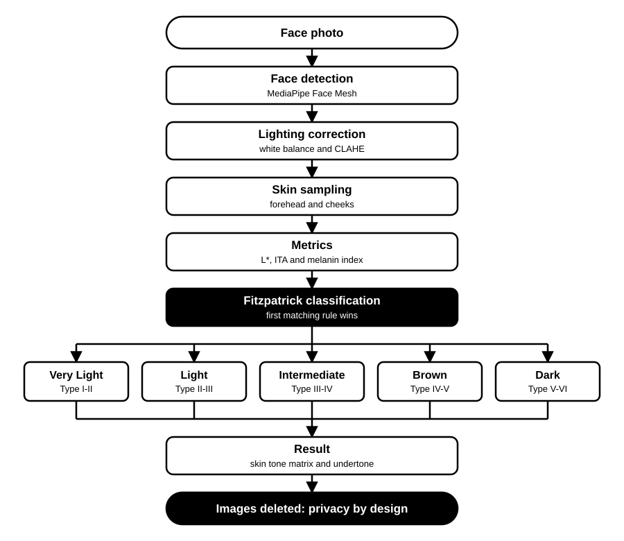

# Skin Tone Analysis using OpenCV and MediaPipe Face Mesh

Skin tone detection from a single face photo. The pipeline locates facial skin regions with MediaPipe Face Mesh landmarks, corrects lighting with OpenCV, and classifies the skin tone using LAB color space, ITA angle, melanin index and the Fitzpatrick scale.

<p align="center">
  
</p>

## Method

1. **Image validation:** size check (100 to 5000 px), low detail check, and exactly one face (MediaPipe Face Detection).
2. **Face verification:** MediaPipe Face Mesh with detection confidence of at least 0.7, face aspect ratio between 0.6 and 1.4, and face coverage between 5% and 80% of the image.
3. **Illumination correction:** gray world white balance, then CLAHE on the L channel in LAB space, blended 70% CLAHE with 30% original.
4. **Skin sampling:** 20 landmark points on the forehead (9) and both cheeks (11), each read as a 3x3 median, followed by IQR outlier removal and averaging to one RGB value.
5. **Metrics:** brightness, ITA angle and melanin index computed from the LAB values.
6. **Classification:** Fitzpatrick class from the rules below, plus undertone.
7. **Output:** detected RGB, class, metrics and an 8 shade skin tone matrix for the class.

## Classification criteria

Metric definitions:

| Metric | Formula |
|---|---|
| Brightness (L*) | L / 255 x 100 |
| ITA (degrees) | atan((L* - 50) / b*) |
| Melanin index | 100 - L* + 0.5 x a* |

a* and b* are measured relative to 128 (OpenCV LAB scale).

The rules are checked from top to bottom, and the first class where Rule A or Rule B is true is assigned.

| Fitzpatrick class | Rule A | or Rule B |
|---|---|---|
| Very Light (Type I-II) | Brightness > 70 and Melanin < 35 | ITA > 55 and Brightness > 65 |
| Light (Type II-III) | Brightness > 60 and Melanin < 45 | ITA > 41 and Brightness > 55 |
| Intermediate (Type III-IV) | Brightness > 45 and Melanin < 60 | ITA > 28 and Brightness > 40 |
| Brown (Type IV-V) | Brightness > 30 and Melanin < 75 | ITA > 10 and Brightness > 30 |
| Dark (Type V-VI) | None of the above | |

Undertone uses the raw a value: below 120 is Cool, 120 to 130 is Neutral, above 130 is Warm.

Only MediaPipe is a trained model. The classification is rule based image processing, so results are estimates that depend on lighting and camera quality. This is not a medical or dermatological tool.

## Privacy by design

- No name, email or account is collected, and only one face per photo is accepted.
- All processing runs locally with OpenCV and MediaPipe. No third party API or cloud vision service is called.
- Analysis uses the cropped face area, and the result depends only on the 20 sampled landmark points.
- The session keeps only derived values (RGB and metrics), never the photo itself.
- The preview shown to the user blurs everything except the sampled regions.
- Clicking **End Analysis** or **Start New Analysis** deletes all uploaded and processed images and clears the session. Every new upload also wipes the previous files.
- The `uploads/` and `static/results/` folders are excluded from Git.

## Tech stack

Python, OpenCV, MediaPipe, NumPy, Flask (used for the demo interface)

## Project structure

```
app.py               analysis pipeline and routes
requirements.txt
templates/           interface pages
static/css/
static/images/
docs/                diagrams
uploads/             temporary uploads (not tracked)
static/results/      temporary outputs (not tracked)
```

## Run locally

Requires Python 3.8 to 3.11 (MediaPipe 0.10.8).

```
git clone https://github.com/Rafa2208/skin-tone-detection-opencv-mediapipe.git
cd skin-tone-detection-opencv-mediapipe
pip install -r requirements.txt
python app.py
```

Open http://localhost:5000 in your browser. The webcam works only on localhost or HTTPS.

## Tips for good results

- Use natural daylight, facing a window, with the face looking straight ahead.
- Avoid harsh shadows, filters and heavy makeup.
- Only one face per photo.

## Limitations

- Temporary files use fixed names, so the demo is meant for one user at a time.
- If a user closes the browser without clicking End Analysis or Start New Analysis, their last images stay on the server until the next upload.
- Classification thresholds are fixed rules, not learned from a labelled dataset.
